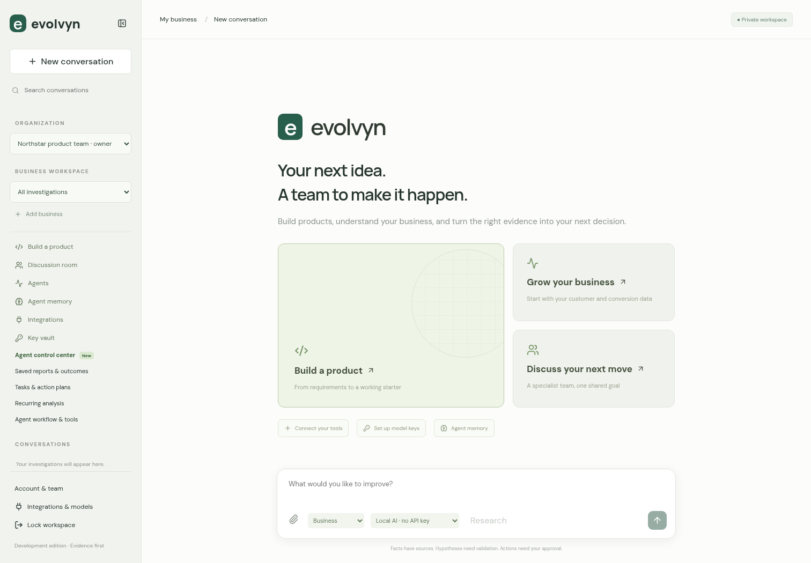
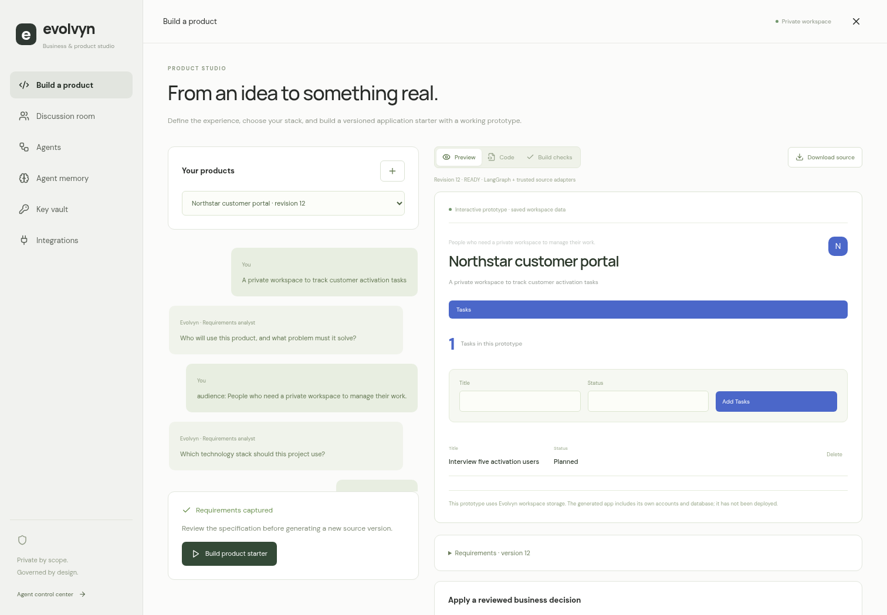
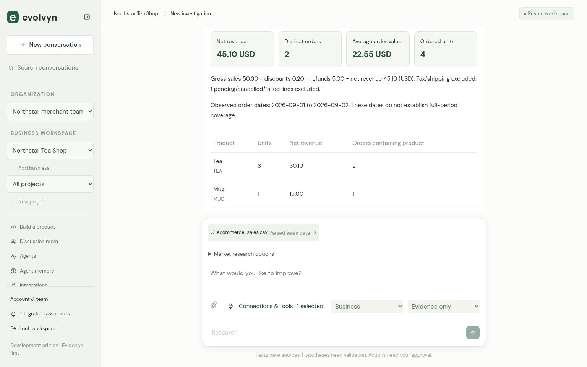
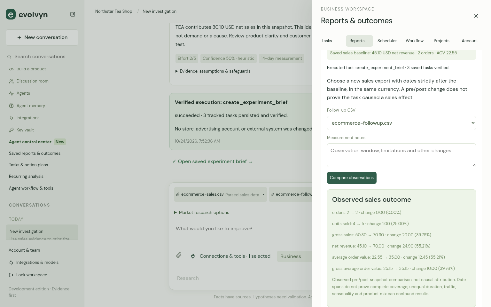
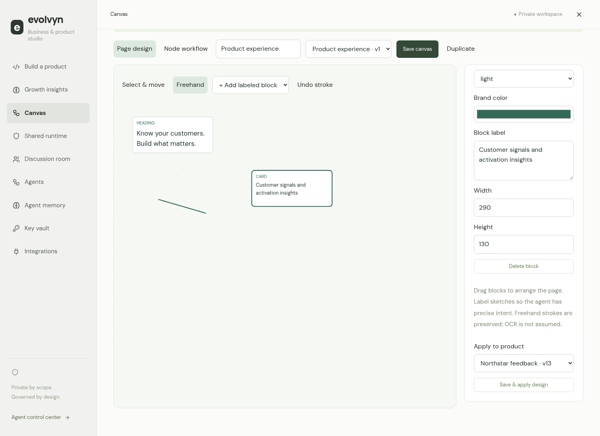
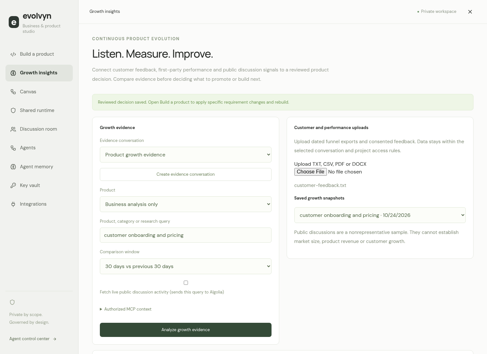
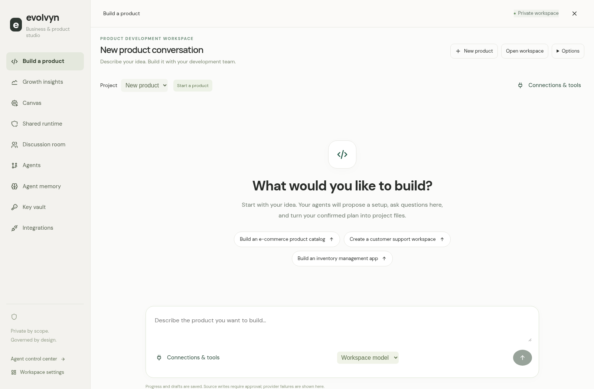
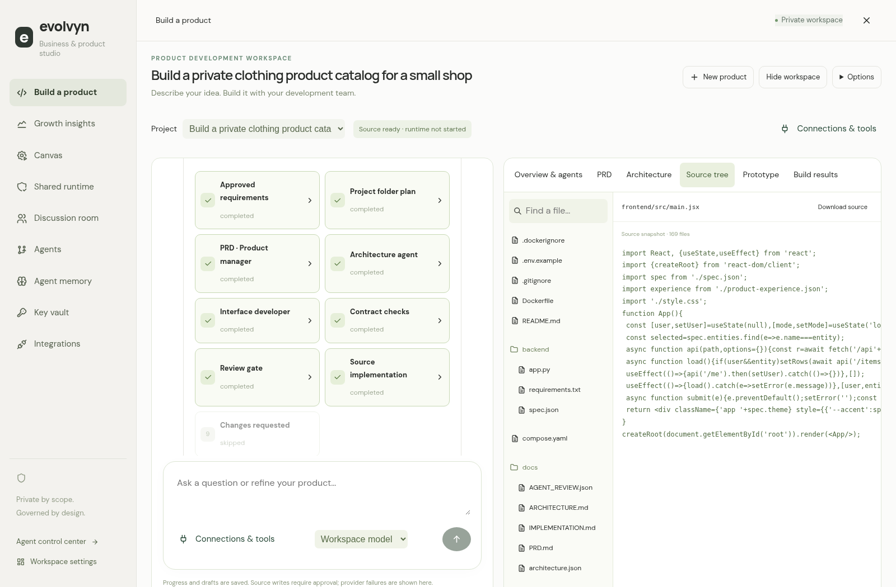

# Evolvyn — Continuous Business Evolution Platform

A conversational workspace that connects business evidence, research, recommendations, human approval, internal execution, and outcome measurement. Built with React/TypeScript, FastAPI, PostgreSQL and a real local MCP strategy tool.

**No OpenAI key is required.** Local AI uses Qwen 2.5 1.5B through a checksum-verified llama.cpp runtime. If the local model is unavailable, the application clearly labels its deterministic evidence analysis and heuristic recommendations. It never presents that fallback as an LLM response.

## Run on your computer with Docker

Install Git, Python 3 and Docker Desktop (including Docker Compose). Start Docker Desktop, then run:

```bash
git clone https://github.com/25955A0512/Evolvyn.git
cd Evolvyn
python scripts/prepare_deployment.py
docker compose --env-file .local/deploy.env up --build -d --wait
```

On macOS/Linux, use `python3` if `python` is unavailable. Open **http://localhost:3000** on that same computer, create an account or select **Try a sample business**, and open **Agent control center** for the registries, execution graphs and governance. To stop the app, run `docker compose --env-file .local/deploy.env down`; the database volume is retained.

This source checkout excludes private data, credentials, model weights and compiled runtime binaries. A fresh Docker start uses the explicitly labeled deterministic evidence mode until the optional local model is installed. The Linux x86-64 setup below installs that model; no OpenAI key is required. Docker builds download their locked dependencies, so Internet access is required for the initial build.

## Development setup on Linux
Requires Python 3.12, uv, Node 24/npm, Docker and Docker Compose on Linux x86-64.

```bash
bash scripts/install.sh
bash scripts/start.sh
```

Create an account, or select **Try a sample business** for an isolated synthetic workspace. Private development-token access is retained as an optional advanced path; its generated token is in ignored, mode-0600 `.local/runtime.env`. Never paste it in chat or commit it.

Installation prepares verified dependencies and downloads the local model when it is not already installed. Model catalogue and binary-CDN access are now working. The pinned model is installed and actual local inference has been verified. To refresh or start the model separately:

```bash
.venv/bin/python scripts/install_local_model.py
bash scripts/start_local_model.sh
```

The model is pinned to an official immutable repository revision and LFS SHA-256 in `config/local-model.json`. Installation and startup reject a modified model. A 1.1 GB download and approximately 2–4 GB inference memory are needed. The runtime itself is installed, checksum-verified, and executable both on the host and in the application container. **Verified:** actual local completion, model-generated schema-validated recommendations, streamed interpretation, approval and internal task creation, with no external API key. A representative full run took about 50 seconds on four CPU cores.

## Container stack

```bash
bash scripts/deploy_local.sh
```

This builds static frontend assets and a non-root API image, starts Nginx and an authenticated PostgreSQL database, and checks readiness. The web port is 3000, bound only to loopback. The API and database are not published. Private deployment secrets are generated in ignored `.local/deploy.env` without displaying them. The offline image build uses hash-verified wheels and the environment's existing public trust bundle; TLS checks remain enabled. Existing proxy configuration is passed at runtime with internal services excluded.

Public Internet hosting has not been performed. To expose a deployment, provide a real TLS reverse proxy and hostname, set PUBLIC_ORIGIN, ALLOWED_HOSTS and COOKIE_SECURE=1, and review operational security. The development trust-auth database is separate from the authenticated Compose database.

## Product studio and specialist agents

Screenshots from a synthetic acceptance workspace:






The interface follows the supplied conversational-workspace reference. Open **Build a product** for the requirements interview, code browser, source download and persistent prototype. Choose React/FastAPI/PostgreSQL or React/Express/PostgreSQL; unsupported custom stacks are saved as requirements and clearly blocked from builds.

Open **Key vault** to save an encrypted provider credential. Set **Organization default** to use it across agents, or select an individual agent for an override. In the business composer or a saved workflow, select **Default agent model route** to use those bindings; explicitly selecting Local AI or Evidence only keeps that mode. Never paste API keys in a chat, tool argument or memory. Credential replacement/revocation is supported. The private vault master key is generated by `scripts/prepare_deployment.py` and provisioned separately from PostgreSQL; back up `.local/vault.key` securely and separately from database backups.

Open **Discussion room**, choose or create an evidence conversation, upload CRM exports/customer feedback, optionally configure registered MCP context tools, and start the specialist team. LangGraph runs the business analyst, marketing analyst, product manager and reviewer with bounded revision loops. Each model result or deterministic fallback is labeled. Approve an edited decision to add reviewed agent memory. In the product studio, **Apply a reviewed business decision** creates an explicit requirements revision without changing previous builds.

The generated starter implements accounts and private entity CRUD. Feature requests outside those adapters are shown as pending requirements. The prototype uses Evolvyn workspace storage; arbitrary generated code is not run in the platform API. Unrestricted code execution, additional stacks and automatic cloud deployment need a separate sandbox/broker. See [implemented modern stack](docs/MODERN_STACK.md) and [cloud recommendation](docs/CLOUD_DEPLOYMENT.md).

## E-commerce: one complete workflow in the existing chat

Create an **E-commerce** business using **Add business**. Upload a supported sales CSV or product catalog in the chat composer. No separate dashboard or new navigation module is needed.

- Try the explicitly synthetic [sales example](sample-data/ecommerce-sales.csv), [catalog](sample-data/ecommerce-catalog.csv) and [follow-up sales](sample-data/ecommerce-followup.csv).
- Sales headers: `order_id,product_id,quantity,unit_price`, with optional `product_name,line_id,order_date,currency,status,discount,refund`. Common aliases include `sku`, `qty`, `price` and `name`. Monetary adjustments are line amounts. Currency is not inferred. Net revenue/net AOV require explicit discount and refund data; otherwise only gross measures are available. One currency per snapshot; at most 5,000 rows/2 MB. Invalid/ambiguous lines are rejected, not silently skipped.
- Catalog headers: `product_id,product_name,unit_price` (or `sku,name,price`), optionally `inventory`/`stock` and `currency`. Catalog prices are not realized sales.
- Ask about revenue, orders, AOV and product performance. Choose **Evidence only** to verify the deterministic path without any model key. The response includes SQL-calculated metrics, definitions, missing data, citations and an explicit proposed investigation.
- Use **Connections & tools** in chat to select registered read-only MCP tools. The same connections are accessible from development, discussion and growth screens. **Market research options** can fetch actual public discussion sources using an explicit public query. An outage is labeled and does not invent market evidence or block internal analysis. These discussions are not verified competitor prices or market-share data.
- Approve the proposed action to invoke the registered tool that creates and verifies real internal tasks and a brief. Its execution receipt states exactly what was written. No external store, ad account or CRM is changed.
- Upload a new dated follow-up sales snapshot, then open **Saved reports & outcomes**. Compare against the stored baseline. The endpoint rejects a renamed baseline, overlapping/undated periods and currency mismatch; duration/coverage and causal limits are shown.

**Agent control center** is the shared configuration and operations area: connect/discover MCP servers, register tools, inspect workflow/approval history and set permissions. Configure a connection there once, then use it where you work through **Connections & tools**. Valid credentials and a successful check are required to claim a live third-party connection.

See the [implementation audit and execution trace](docs/ECOMMERCE_AUDIT.md) for actual gaps, metric definitions, supported actions, verification and remaining integration limits. CSVs uploaded before this importer should be re-uploaded to create structured datasets. Merchant-specific column formats need a mapping adapter; native Shopify/social/ad integrations have not been claimed connected.





## Connected growth, canvas and product runtime

Open **Build a product** (or **Grow your business**) and use the studio navigation:

- **Growth insights:** upload feedback and dated funnel exports, optionally fetch two comparable windows of public discussion activity, and review source-linked experiment suggestions. Dated first-party conversion changes and public discussion counts are labeled separately. Source outages retain first-party analysis without inventing a trend. Optional read-only MCP context is governed by the same data policy.
- **Canvas:** add and drag labeled page blocks, annotate with freehand strokes, save revisions, inspect the generated design prompt, and apply a design to a product requirements revision. Rebuild to include its layout in the prototype and source. Freehand annotations are preserved; no OCR or arbitrary sketch-to-code capability is claimed.
- **Node workflow:** add agent/tool/condition/approval/result nodes, connect branches, edit arguments and execution budgets, and run the graph through the existing harness. Pending writes and review nodes pause for explicit approval. Cycles remain bounded by visits, steps, calls, tokens and time.
- **Shared runtime:** inspect the actual services and filter the tool ontology by entity and action. It connects to the existing registry, gateways, memory and governance rather than a duplicate execution engine.

Product ZIPs now include the complete Evolvyn runtime source and console, with an isolated database, private network, unique browser-cookie namespace and fresh accounts/vault. Within the downloaded product, run:

```bash
python scripts/prepare_product.py
docker compose up --build -d --wait
```

The generated product runs at `http://localhost:8000`, and its included agent console at `http://localhost:3001`. These addresses apply to the computer running that downloaded product. No existing keys, model files, tenant records or integration instances are copied. Product data reaches agents only through authorized uploads or an explicitly configured connector. The runtime adds services and memory requirements; review resources and TLS/secrets configuration before cloud deployment. Additional requested domain features remain visible as pending work, not silently implemented by the templates.





## Google, GitHub and account security

Email/password accounts work immediately. Optional Google and GitHub login uses authorization code + PKCE, browser-bound expiring single-use state, verified provider email, hashed revocable sessions and fixed provider endpoints. An existing email is never automatically linked: sign in with the original method, then explicitly link the provider in **Account & team → Account security**. That panel also changes passwords (revoking all sessions) and signs out all devices.

To enable live sign-in, create OAuth applications with the provider, register the matching callback URLs, and add these variables to the private **`.local/deploy.env`** file. Keep actual client secrets out of chat and source control:

```dotenv
OAUTH_GOOGLE_CLIENT_ID=
OAUTH_GOOGLE_CLIENT_SECRET=
OAUTH_GITHUB_CLIENT_ID=
OAUTH_GITHUB_CLIENT_SECRET=
```

Local callbacks are `http://localhost:3000/api/auth/oauth/google/callback` and `http://localhost:3000/api/auth/oauth/github/callback`. For hosting, use your HTTPS `PUBLIC_ORIGIN`, update the registered callbacks and set `COOKIE_SECURE=1`. Re-run Docker Compose after configuration. Unconfigured sign-in providers remain unavailable. Google/GitHub protocol and security behavior are tested with mocked provider responses; real provider login requires these credentials and has not been live-validated. MFA, recovery/email verification and an independent production security review remain launch work.

## Working features

- Email/password accounts with scrypt hashes, HttpOnly sessions, organization isolation and owner/admin/editor/viewer roles.
- Business profiles, goals and projects. Local-only project policies prevent remote model requests.
- Persistent, searchable conversations with grouped history, Markdown, streamed execution updates and cancellation.
- Validated TXT/CSV/PDF/DOCX ingestion. Binary documents are parsed in a bounded child process.
- Numerical funnel calculations, keyword signals, lexical passage retrieval and source citations. Related conversations can reuse evidence only within the same business/project scope.
- Structured recommendations with evidence, assumptions, risks, effort, measurement plans and rollback guidance. Model proposals are schema-checked and unsupported citations are rejected; the fallback is labeled.
- Real LangGraph specialist handoffs and bounded review loops; versioned product requirements and two source-build adapters.
- Encrypted key vault, default/per-agent model routing, reviewed agent memory and scoped persistent prototypes.
- Persistent MCP server registry with two bundled stdio profiles, HTTPS transport, organization-scoped credential references, health checks and schema discovery.
- Persistent built-in/MCP tool adapters, capability and business-entity discovery, schema validation and single-use approvals bound to exact arguments and configuration.
- Declarative agent graphs with conditional branches, joins, bounded loops, durable checkpoints, transient retries and call/time/output-token budgets.
- Central organization policy for tool access, risk and external processing, plus restricted project membership enforced on linked resources.
- An Agent control center for MCP connections, tool registration/invocation, graph planning/execution and governance.
- Editable approval creating a real internal brief and tasks atomically, with replay prevention.
- Task status/notes and follow-up CSV comparisons against the stored baseline. Comparisons do not claim causality or invented business improvements.
- Persisted recurring analysis, manually triggered runs, bounded PostgreSQL worker leases, and recovery from completed evidence/strategy checkpoints.
- A draggable workflow canvas and saved templates whose research, provider, source and recommendation settings affect actual execution. Approval cannot be disabled.
- Five uploaded-log agent interfaces: alert triage, log analysis, change analysis, runbook retrieval and verification prerequisites. This is not a connected production monitor.
- Public discussion research with URLs and retrieval/publication timestamps; these are discovery leads rather than verified market claims.
- Local/OpenAI/Groq/Gemini provider adapters, bounded context, provider-reported usage when returned, and payload-free audit records. Remote providers are optional and require their own credentials/network access.

## Demonstrate

1. Create an account and business, or open the synthetic sample.
2. Upload `sample-data/funnel.csv` and `sample-data/customer-feedback.txt`.
3. Choose your configured vault route (the default) and ask what to investigate. Evidence only is available for a fast deterministic comparison; it does not call an AI provider. Agent runs fail visibly when their provider is unavailable instead of silently substituting a response.
4. Inspect calculated conversion (8% then 5%), cited text and recommendation cards.
5. Select a recommendation, edit the plan, approve, and inspect the created tasks.
6. Upload `sample-data/followup.csv`; compare observations in Reports & outcomes. The synthetic follow-up is 6%, a one-percentage-point pre/post difference, not proof of improvement caused by an action.
7. Open workflow tools, drag/save a layout, change the recommendation limit, and run the saved workflow.
8. Refresh and reopen history; use Account & team to inspect membership and audits.
9. Open Agent control center to register/check MCP servers, bind a discovered tool, generate/save/run an execution graph, and approve its exact write arguments. Governance controls organization policy and project membership.
10. Optionally upload `sample-data/service-logs.txt` and select Uploaded logs to run the operational checks.

## Verify and preserve

See [agent visibility, platform help and Canvas automations](docs/EXPERIENCE_UPDATE.md) for the latest UI changes, private Gemini/Groq configuration and a manual acceptance walkthrough.

The [workspace visual refresh](docs/VISUAL_WORKSPACE.md) adds supplied connector/provider logos, locally hosted licensed icons, illustrated entry cards and a contextual composer menu while keeping the existing agent execution and approval workflows.

The [recording-driven interaction update](docs/REFERENCE_INTERACTIONS.md) adds persistent account appearance preferences, nested context menus, runnable agent capabilities and the shared connector gallery inside Integrations.

```bash
.venv/bin/python -m pytest -q
npm --prefix frontend run build
EVOLVYN_TEST_URL=http://localhost:3000 python3 tests/e2e_account.py
python3 tests/e2e_control_center.py
python3 tests/e2e_studio.py
python3 tests/e2e_evolution.py
python3 tests/e2e_commerce.py
python3 tests/e2e_experience.py
python3 tests/e2e_visual_workspace.py
python3 tests/e2e_reference_interactions.py
.venv/bin/python tests/live_exported_runtime.py
bash scripts/backup.sh
```

130 automated tests pass against an isolated temporary PostgreSQL schema. Chromium validated account creation, private uploads, analysis/approval, refresh persistence, team access, canvas editing and a saved workflow running with its configured recommendation count. Docker images build and all three services pass readiness. Public research also succeeds through the container's configured proxy. Actual local inference and model-generated recommendations passed earlier acceptance runs. The most recent strict local-AI acceptance run rejected structured proposals and used the labeled heuristic fallback; that strict check failed. A subsequent deterministic upload/analysis/approval/task run passed. Public Internet hosting has not been performed.

Backups keep the development database and Compose data separately in ignored mode-0600 files. An empty Compose database is restored by the deploy script; existing records are not overwritten. Protect backups as business data. Cloud publication and restoration in a new task remain separate, unverified platform steps.

Known remaining work: embedding-based semantic retrieval, identity recovery/email verification, additional business service connectors, production incident actions, robust model evaluation and public deployment. See `docs/PROGRESS.md` for current scope.

Remote MCP credentials are optional. Add the hostname in Governance, register its HTTPS endpoint, and use the organization-specific environment-variable prefix displayed in the form. Supply the actual value through private runtime configuration; Compose optionally reads ignored `.local/mcp-secrets.env`. Redeploy after changing credentials. Never paste a key into tool arguments or an endpoint URL. Bundled stdio profiles need no credentials. Remote transport and policy boundaries have automated coverage; no third-party authenticated MCP deployment was available for live acceptance.

Current studio acceptance: the generated FastAPI application was executed with private-account CRUD tests; a generated React frontend compiled; the generated Express backend ran against an isolated real PostgreSQL schema and passed account/CRUD/isolation checks. The full studio browser flow passed on desktop and mobile. Four actual local Qwen specialists completed LangGraph handoffs without fallback in 134 seconds; the reviewer flagged a missing citation, leaving a human review gate. Optional remote model credentials and third-party CRM/social MCP services have not been live-validated.

Previous connected-runtime acceptance: **103 tests passed** against isolated PostgreSQL schemas. The growth/canvas browser journey exercised upload, specialist handoffs and decision approval, page drawing, visual node connections, workflow approval/resume, tool ontology filtering, runtime source download, reload persistence and mobile layout. Existing account, studio and registry/governance browser regressions also passed. Exported product and agent-console frontends compiled; the exported API ran independently, discovered and invoked a real stdio MCP tool, enforced a tool denial, and generated a complete nested product export. The live public research connection returned actual indexed discussion counts; these were not treated as market-growth facts.

Latest e-commerce acceptance: **130 tests passed** with independent per-test PostgreSQL schemas. The live Chromium chat journey passed business creation, structured sales import, exact SQL metrics, real bundled MCP context, successful live public-source research, proposal/approval, verified internal task creation, follow-up comparison, reload persistence and mobile layout. Existing account, registry/governance and product-studio browser flows also passed. See [ECOMMERCE_AUDIT.md](docs/ECOMMERCE_AUDIT.md). Test-file revenue changes are observations, not claimed business lift.

Latest experience acceptance: **138 tests passed**, including isolated support-provider failover, credential separation, durable upload automation dispatch, deduplication and revoked-creator enforcement. Live browser checks passed compact results/approval visibility, connector setup, conditional reviews, unavailable help, persistence and mobile layout; account, registry, studio and e-commerce regressions passed. Exported product/runtime frontends compiled and the independent exported API passed MCP/governance checks. Gemini/Groq help responses are tested using mocked HTTP transport; live acceptance requires private service credentials and available model IDs. See [EXPERIENCE_UPDATE.md](docs/EXPERIENCE_UPDATE.md).

## Product development workspace

Open **Build a product** and type your idea in the full-width conversation. No name form or initial questionnaire is required. The model proposes a starting setup for review and asks follow-up questions in that chat. **Confirm setup & start building** saves the reviewed decisions and starts the durable backend workflow in the same request. The planned folder pane opens as the agents work; phase results, review issues and source approval appear in the conversation. Leaving the module does not cancel the job: returning or refreshing restores the selected product, history, files and current execution. **Source tree**, **Prototype**, and **Build results** show different stages explicitly. A reviewer rejection stops source creation until the plan or selected workflow is revised. **Options → Guided form · no model** remains available. Supported source adapters implement private accounts and entity CRUD; requested domain features and integrations remain listed as pending until separately implemented and verified. Builds do not automatically deploy a live application.





The private compiler container validates frontend bundles without executing generated application code. When updating an existing checkout, run `python scripts/prepare_deployment.py` before rebuilding containers so its private authorization token is created. Never replace or delete an existing deployment environment or vault key.

## Sign in, connect GitHub and use your saved Gemini key

Google and GitHub sign-in/sign-up buttons now include administrator setup guidance when OAuth applications are unconfigured. Follow the exact callback/client configuration shown there; save secrets only in ignored `.local/deploy.env`, then recreate the API container. **Integrations → Connect GitHub** authorizes a real read-only public-repository MCP adapter. Other providers need their own authorized endpoint; GitHub does not authorize them.

A single saved, unassigned Gemini key is selected as the workspace default. To replace old local/evidence/per-agent bindings, open **Key vault → Use for all agents** beside that saved key. The existing key stays encrypted; no re-upload is needed. Test a model route before relying on it. Project local-only restrictions remain enforced. See [connected identity and routing](docs/CONNECTED_IDENTITY.md) for setup, verified boundaries, PRD DOCX, permissions and remaining release work.
