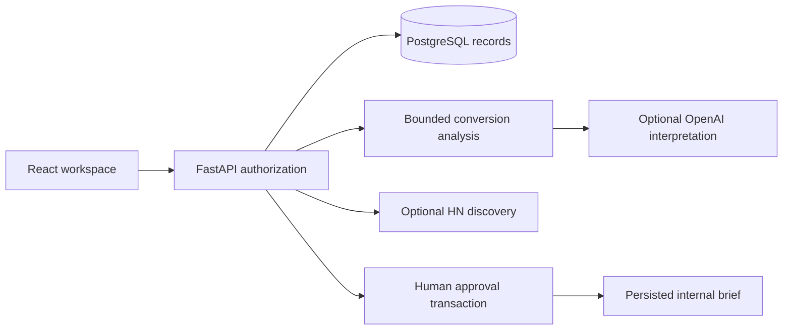

# Architecture
The React conversational UI calls FastAPI through the Vite development proxy. FastAPI validates bearer authentication, reads authorized PostgreSQL records, retrieves ranked text passages, calculates structured observations, runs bounded background tasks, optionally streams interpretation from a fixed OpenAI provider, and persists execution state. The UI consumes persisted live SSE snapshots and can stop active work. Approval writes the decision, terminal state and internal brief in one row-locked transaction.

`backend/app.py` contains the initial API and workflow functions; provider streaming and lexical retrieval live in backend/providers.py and backend/retrieval.py. Split persistence, policy and workflows into modules as the next milestone. The JSONB record store uses owner and kind filters on every object lookup. This supports the initial private workspace, not a production multitenant identity system. PostgreSQL schema creation is idempotent at startup; adopt versioned migrations before schema changes or deployment.
