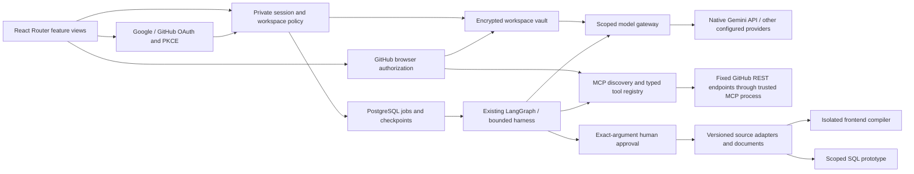

# Connected identity and agent routing

The existing React/FastAPI/PostgreSQL application is retained. This revision fixes credential resolution and adds browser authorization, real read-only GitHub MCP tools, routed feature views and versioned PRD documents. It does not complete every acceptance criterion in `PRODUCT_REQUIREMENTS.md`.

## Actual paths and boundaries



The compiler does not evaluate generated code. The prototype is not an arbitrary generated application runtime. Private repository access, repository writes, unrestricted code execution and cloud deployment are not enabled by this change.

## Gemini default and diagnostics

A single active Gemini credential without an explicit route resolves as the workspace default. Multiple Gemini keys require a chosen binding; no key is guessed across organizations. Explicit local/evidence/per-agent routes remain authoritative. **Key vault → Use for all agents** writes the selected default and removes per-agent overrides atomically. It retains an existing model choice for that credential when the caller does not specify another one. Explicit provider selection can use the corresponding saved key even when another default is selected.

Gemini calls use its native fixed HTTPS endpoint and an `x-goog-api-key` header. Flash 2.5 thinking is disabled for short agent contracts so hidden thinking does not consume their response budget. Empty, blocked and truncated responses are failures, not successful generated documents. Keys never enter prompts, checkpoints or read APIs. Agent errors distinguish quota, credential/model access, connectivity, output validation, policy and time limits. Model test buttons make actual gateway calls; metadata alone does not establish provider connectivity.

Platform help can use the workspace default when separate support-service credentials are absent. Only platform reference material and the help thread are supplied; business documents and agent memory are not read into that fallback. Service credentials remain separate from workspace agent credentials.

## Google/GitHub signup setup

Both sign-in/sign-up buttons are visible. Unconfigured providers open setup guidance instead of pretending to be connected. Create web OAuth applications using the console links in that guidance, then add the client ID/secret privately to the existing ignored `.local/deploy.env`:

```
OAUTH_GOOGLE_CLIENT_ID=
OAUTH_GOOGLE_CLIENT_SECRET=
OAUTH_GITHUB_CLIENT_ID=
OAUTH_GITHUB_CLIENT_SECRET=
```

Register the exact callback URLs displayed by Evolvyn. For the default local deployment they are `http://localhost:3000/api/auth/oauth/google/callback` and `http://localhost:3000/api/auth/oauth/github/callback`. Google consent screens in testing require test users. Recreate the API container after configuration. No client-secret value is returned by the setup API. A Gemini API key cannot substitute for OAuth application credentials.

OAuth validates fixed destinations, state, PKCE, browser binding, expiry and one-shot consumption. Existing email accounts are not silently linked. Successful sign-in returns through `/auth/callback`, verifies the new HttpOnly session without an old workspace override, then establishes the current workspace in the UI.

## Native GitHub connection

Open **Integrations → Connect GitHub**. It uses the configured GitHub OAuth application and the same registered callback, with a separate browser-bound connector state and active initiating-session/membership checks. The access token is encrypted in the existing vault. A trusted MCP subprocess discovers the actual tool schemas and registers `github_repository`, `github_issues` and `github_repositories` as read-only capabilities. Only public repository responses are accepted; missing/private classification is rejected. Paths, methods, limits, response sizes and destinations are fixed/validated. No arbitrary command or user-chosen API URL is executed.

Connection testing rechecks both MCP discovery and the GitHub identity. Freshness, unavailable authorization and organization policy blocks are surfaced. Disconnect erases the local credential and disables the server/tools. It does not claim to revoke the upstream OAuth grant: the UI explains how to revoke that grant in GitHub settings. Other MCP providers still require their own configured endpoint/authorization. A GitHub authorization does not connect Slack, Drive or Notion.

## Permissions, routes and documents

The discussion role can read permitted resources and ask agents in an existing conversation; it cannot edit business data, manage integrations/vault/policy, approve or execute writes. Project and local-only data policy still apply, including to the native GitHub MCP profile. Discussions without uploads invoke the model with no internal facts, expose no fabricated metrics and still require approval before saving a decision.

React Router supports direct module links, refresh and back/forward navigation. Major workspace/control/panel views are lazy-loaded with a failure boundary. `/api/v1/` is a backwards-compatible entry point to the existing authenticated handlers; legacy `/api/` clients remain supported. Server-side permissions remain authoritative.

PRD drafts have revision conflict checks and real DOCX downloads. Unsaved editor contents are preserved across late fetches and cannot be downloaded as if saved. Draft edits are context for subsequent generation, not an implicit change to confirmed requirements or immutable source builds. New data uses existing scoped JSONB record kinds (`connector_oauth_state`, `integration_connection`, `product_document`); no destructive database migration is needed. The discussion role is an additive membership value.

## Logging and verification limits

Nginx logs the path without query arguments, at server scope to override inherited logging. Uvicorn raw access logs are disabled in supported launch scripts. The API emits only safe request ID, method, route template, status and duration metadata. Authorization codes, state values, bodies, cookies and keys are excluded. A live synthetic-code test checks both actual API and proxy logs.

External OAuth/Gemini boundaries are validated with explicitly mocked transports; GitHub MCP discovery uses the real stdio protocol. No live OAuth applications or Gemini credential exist in this cloud workspace. Keys saved in a user's local Docker database are not available here and are not copied. Live provider acceptance therefore remains a required local check.

Remaining production work includes a general MCP OAuth adapter framework, private-repository GitHub App scopes/writes, granular project capability UX, independent worker deployment and fair tenant quotas, pooled/asynchronous database access, full telemetry and workload benchmarks, sandboxed arbitrary application execution/repair/preview, source editing/diffs/rollback, and actual cloud security/recovery release validation.

## OAuth launch hardening

Pending sign-in/link/connector states are now bound to a configuration fingerprint so changing the client or callback invalidates the pending authorization. Explicit identity linking revalidates the initiating session and organization membership before and after the provider request, preserves the initiating organization, and rejects a second conflicting identity for the same provider. These use additive OAuth-state columns; existing accounts/data are preserved and pending pre-upgrade authorizations must restart.

Origins must be HTTP loopback or valid HTTPS origins without userinfo, paths, queries or fragments; HTTPS requires Secure cookies. Host-prefixed transient OAuth cookies use root paths. Fixed-provider reads have byte limits, schema checks and bounded time. Browser callback failures show safe recovery links without reflecting codes/state; auth responses are not cached. Credential setup is private through `scripts/configure_oauth.py`, with hidden input and an offline `--check` that never claims live verification.

See [AWS_FIRST_DEPLOYMENT.md](AWS_FIRST_DEPLOYMENT.md) for a concrete single-instance HTTPS deployment and its limits. AWS provisioning and real Google/GitHub authorization remain unverified until an operator supplies the domain and registers the applications.
