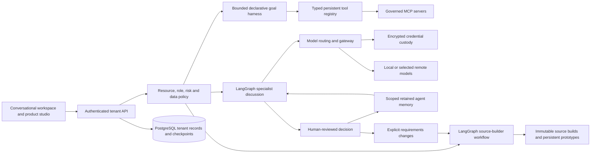

# Business and product orchestration

This document describes implemented behavior. It does not claim parity with proprietary coding platforms or production certification.

## Components and boundaries

- **LangGraph:** real StateGraph execution for business analyst → marketing analyst → product manager → reviewer. Conditional reviewer → product-manager loops have a configured round limit and a hard graph recursion limit. Completed role outputs are checkpointed in PostgreSQL and replayed during recovery; no model credentials or executable serialized Python objects are checkpointed. External LangSmith tracing is disabled for private workflows.
- **Goal harness:** declarative agent/tool/condition/approval/result nodes, reference passing, branches, joins, bounded cycles, configurable node visits, deadlines, output-token reservation and conservative tool budgets. A PostgreSQL lease separates durable queue state from live processes. Agent IDs resolve to role contracts, model routes and capabilities. Tool results cannot mint approvals.
- **Registry/MCP:** persistent organization-scoped adapters, capabilities, schemas, connection health, two real stdio profiles and approved-host HTTPS MCP. Stdio profiles cannot run arbitrary commands or inherit instance secrets. Remote credentials can reference encrypted vault entries or scoped operator environment bindings. Private addresses, unapproved hosts, redirects and credential-bearing URLs are rejected.
- **Gateway:** fixed-destination local/OpenAI/Groq/Gemini/OpenRouter adapters. Every agent may inherit one organization route or have an override. Keys are used in outbound headers, never prompts. Project external-processing policy is rechecked before outbound model calls. The discussion gateway bounds retries, output and time; rejects credential reflection; retains only known numeric usage fields; and labels deterministic fallback. A cheaper or different external provider is never selected silently on failure.
- **Memory:** accepted facts, preferences, decisions and lessons with project/agent scope, provenance, retention and forgetting. Draft/rejected/expired memory is excluded. Current retrieval is lexical and explicit; vector semantic retrieval is not implemented. Working memory is the run checkpoint; reviewed decisions provide cross-session memory; role contracts and uploaded runbooks provide procedural guidance. Retrieved text remains untrusted data.
- **Discussion to product:** approving a discussion stores a reviewed decision. A user can apply explicit field changes from that decision to a new product-requirements revision. Prior source artifacts remain immutable. Model proposals never update a product plan on their own.
- **Product builder:** requirements interview covering users, stack, theme/color, features, entities/fields, accounts, privacy, integrations, acceptance criteria and deployment constraints. Verified adapters generate themed React + FastAPI/PostgreSQL and React + Express/PostgreSQL starters with private accounts and CRUD. Arbitrary requested stacks are retained as requirements and blocked from unsupported builds. Requested features outside the adapter's implemented capabilities remain visible as pending work.
- **Execution safety:** the API validates generated source and serves a scoped interactive prototype; it does not execute arbitrary generated code. Generated applications have separate credentials and databases when run from the exported source. A cloud code sandbox and deployment approval bound to artifact digest remain required for unrestricted code generation/execution.
- **Governance:** owner/admin credential administration, organization isolation, project ACLs, role capability sets, backend risk/allowlist controls, data export restrictions, payload-free audits and argument/configuration-bound approvals. Background membership and provider data policy are revalidated; periodic work preserves its creator. These controls require independent security review before production use.

## Operations

Use Windows Command Prompt with Docker Desktop and the README commands. After updating, run `python scripts/prepare_deployment.py` before Docker Compose so a private vault master key is provisioned. The API remains UID 10001; a network-disabled initialization container seeds a mode-0600 key into a separate named volume. Keep `.local/vault.key` in a separately secured backup; restoring the database without the original key cannot decrypt credentials. Credential replacement/revocation is implemented; master-key re-encryption/rotation is an operational task, not an automatic endpoint.

See [cloud deployment](CLOUD_DEPLOYMENT.md) for the AWS recommendation and production launch gates. The company can keep the same logical boundaries on Azure if that is its approved cloud.

## Useful entry points

- `backend/discussion.py`, `backend/graph_harness.py`: orchestration and checkpoints.
- `backend/vault.py`, `backend/model_access.py`, `backend/agent_gateway.py`: credential custody, routes and role execution.
- `backend/agent_memory.py`: memory lifecycle and retrieval.
- `backend/product_studio.py`, `backend/product_templates.py`: requirements, immutable builds, source adapters and prototypes.
- `frontend/src/components/AgentWorkspace.tsx`, `ProductStudio.tsx`, `DiscussionRoom.tsx`: user-facing workflows.

## Connected runtime extension

`backend/growth.py` combines first-party evidence with optional bounded public discussion windows and authorized read-only MCP observations. Growth reports feed the same LangGraph discussion service; approved decisions become scoped memory and explicit product requirement revisions. Measurements, public activity and experiment hypotheses remain separate.

`backend/canvas.py` persists bounded structured drawings, freehand annotations, design prompts and executable graph drafts. It checks scope/revisions before applying a design. Published graphs use `graph_harness.py`; there is no canvas-only executor. `backend/runtime_catalog.py` provides discovery and entity/action ontology over the real tool catalog. Custom registrations extend semantic metadata while schemas, capability/risk checks and approval rules still govern invocation.

`backend/runtime_export.py` packages an allowlisted copy of the actual runtime source alongside each generated application, with fresh database/vault/accounts, separate private networks, a unique browser-cookie namespace and a separate console origin. It exports neither secrets nor existing tenant resources. The service can itself create products. It requires authorized uploads/connectors to ingest product data; it is not automatic access to the application's private database. Source generation still uses trusted adapters, not unrestricted code execution.

`backend/oauth.py` supplies Google/GitHub authorization code + PKCE, verified identity, explicit linking and session/password controls. Optional credentials are deployment configuration, never model prompts. Mocked-provider acceptance covers both providers; live provider sign-in remains unverified until credentials are configured.

## Structured commerce path

`backend/commerce.py` validates sales/catalog imports and persists normalized dataset/line tables. SQL exact-numeric aggregation provides financial observations; lexical retrieval and LLMs do not calculate revenue. The existing chat worker receives those metrics plus explicitly authorized read-only connector evidence from `evidence_tools.py`. Existing proposal/approval/report screens consume the results. `create_experiment_brief` is a real internal-write tool with one-shot approval and verified task persistence; `platform_api.py` compares authorized follow-up sales against the saved baseline. Missing financial inputs remain unknown. The source/action/test audit is in ECOMMERCE_AUDIT.md.
